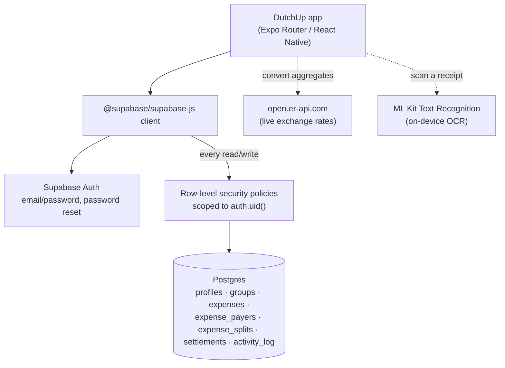
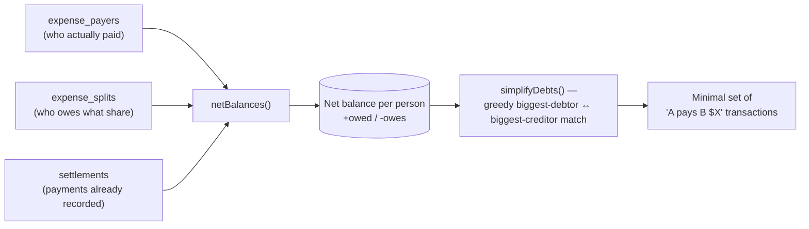
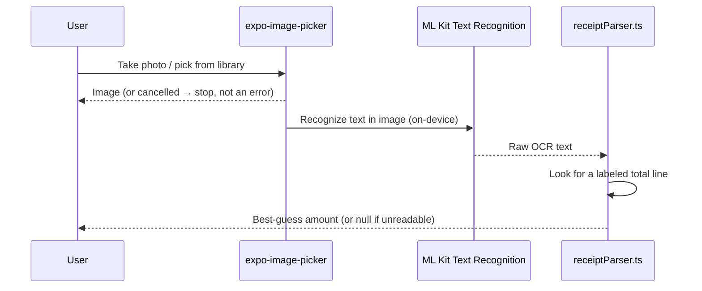
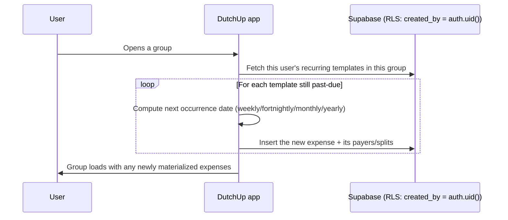
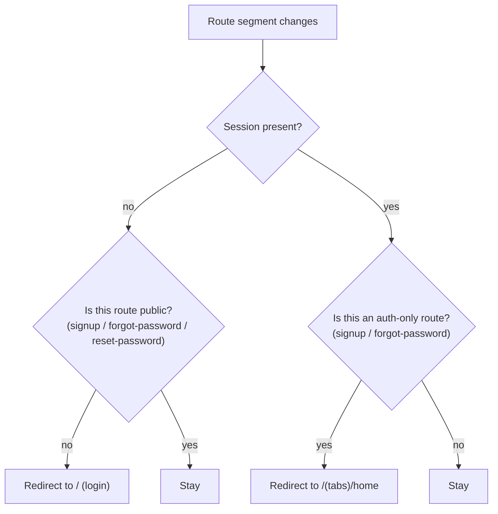

# DutchUp

**A Splitwise-style expense-splitting app** — groups, shared expenses, itemized receipts, debt simplification, and multi-currency balances, all backed by Supabase (Postgres + Auth + row-level security) rather than a custom backend.

     

---

### Contents

[What this is](#what-this-is) · [At a glance](#at-a-glance) · [Architecture](#architecture) · [Splitting & settling up](#splitting--settling-up) · [Receipt scanning](#receipt-scanning) · [Recurring expenses](#recurring-expenses) · [Multi-currency](#multi-currency) · [Auth & routing](#auth--routing) · [What's simplified](#whats-simplified) · [Project structure](#project-structure) · [Getting started](#getting-started)

## What this is

A group creates shared expenses, splits them equally, by exact amount, by percentage, or item-by-item, and DutchUp tracks who owes whom. Rather than settle every pairwise debt individually, it reduces a group's whole web of balances down to the fewest transactions that would clear it. Every table in Postgres is scoped by row-level security to the signed-in user's own groups — there's no application-layer authorization check standing in front of the database; the database itself refuses the wrong row.

The original 9 screens came from an approved design ("Delft"), built out across three phases (auth/groups/expenses/balances/settle-up/activity → categories/comments/CSV export/recurring expenses → itemized splitting/live currency conversion/spending charts), with receipt OCR, theming, i18n, and a few more screens (Settings, Search, Add Friend) added since.

## At a glance

| | |
|---|---|
| **Platform** | Expo (React Native 0.86), iOS + Android + web (phone-width-constrained on web) |
| **Navigation** | Expo Router, typed routes — a tab shell (Home, Groups, Activity) plus stack screens for auth, group/expense detail, settle-up, and settings |
| **Backend** | Supabase — Postgres tables, email/password auth, and row-level security policies scoping every table to `auth.uid()`'s own groups/expenses; no server code of this app's own |
| **State** | `AuthProvider` (session/profile), `ThemeProvider` (light/dark, persisted), `LanguageProvider` (9 locales, persisted) — all context, no global store |
| **Data fetching** | Plain Supabase queries per screen (`src/lib/queries.ts`), refetched on focus — no realtime subscription, so another device's change needs a re-visit to show up |
| **Debt math** | Pure, currency-agnostic functions (`src/lib/balances.ts`) — net balances, then a greedy min-transaction simplification |
| **Currency** | A currency per expense, converted to each viewer's own default currency for aggregates, via a free live-rate API cached for an hour |
| **Receipt OCR** | On-device — `expo-image-picker` + `@react-native-ml-kit/text-recognition`, no cloud call, no API key |
| **i18n** | English, French, German, Spanish, Czech, Portuguese, Italian, Hindi, Turkish |

## Architecture



Every query goes through the same Supabase client and the same RLS layer — there's no separate admin/service path in the app, so what a signed-in user can see and change is enforced the same way regardless of which screen asks. The two dotted integrations (rate lookup, OCR) are both best-effort: a failed rate call degrades to a 1:1 conversion rather than blocking a balance screen, and OCR runs entirely on-device, so there's no key to configure and no network dependency for it to fail.

## Splitting & settling up

A group's balances come from two pure functions in `src/lib/balances.ts`: `netBalances()` folds every payer, split, and settlement into one signed number per person (positive = owed money, negative = owes money), and `simplifyDebts()` then greedily matches the biggest debtor against the biggest creditor until everyone nets to zero — turning, say, five people's tangled IOUs into the smallest number of actual payments that would settle the group.



"Settle up" only **records** a payment (`settlements` insert) — it doesn't move real money. The Easypaisa/JazzCash/bank rows there are UI placeholders for wiring to a real payment deep link later.

## Receipt scanning

Add Expense → "Items" mode can prefill a total from a photographed receipt, entirely on-device: `expo-image-picker` captures or picks the image, `@react-native-ml-kit/text-recognition` reads the text locally, and a pure parser (`src/lib/receiptParser.ts`) guesses the total — checking labeled lines ("Grand Total", "Amount Due", "Total") before falling back to the largest number anywhere on the receipt.



Itemized expenses are create-only today — editing one afterwards isn't supported yet.

## Recurring expenses

A recurring expense has no cron or scheduled job behind it — it's a client-side catch-up. Opening a group checks the current user's own recurring templates in that group and inserts any past-due occurrences right there, before the screen's data loads.



Because every insert is RLS-gated to `created_by = auth.uid()`, this only ever advances when *the template's own creator* opens the group — no other member's client can generate someone else's recurring occurrence. A real schedule (occurrences appearing on time regardless of who opens the app) would need a Postgres cron job or a Supabase Edge Function, which isn't set up here.

## Multi-currency

Every expense has its own currency, and its own ledger row/detail screen always shows that original amount unconverted — a single expense's payers and splits never mix currencies, so there's nothing to convert to display it correctly on its own. Aggregates (Home totals, a group's hero balance, spending charts) convert into the *viewer's* `profiles.default_currency` using a free, keyless rate API, cached per base currency for an hour, falling back to a 1:1 rate if the API is unreachable rather than failing the screen.

## Auth & routing

`useProtectedRoute()` in `src/app/_layout.tsx` is the entire route guard: it watches the current Supabase session and the active route segment, and redirects — no session on a protected route bounces to the login screen; a live session on an auth-only route (signup, forgot-password) bounces to Home.



## What's simplified

- Google sign-in is a UI placeholder — email/password auth is fully wired to Supabase, OAuth is not configured.
- Adding people to a group is by exact-email match; an unmatched email shows as "invited" for that session only — there's no pending-invite table yet.
- Expenses always have a single payer (the current user) — "multiple payers" is a UI placeholder.
- No realtime subscriptions — screens refetch on focus, so another device's change needs a re-visit to appear.
- Push notifications are settings-only (mute/unmute per group); nothing actually sends a push yet — that needs `expo-notifications` plus a server-side sender.
- CSV export shares plain text via the OS share sheet on native, and downloads a real `.csv` on web — native isn't yet a true file attachment.

## Project structure

```
src/app/                  Expo Router routes — (tabs)/ shell (Home, Groups, Activity) plus
                           auth screens, group/expense detail, settle-up, settings, search
src/lib/
  supabase.ts              Supabase client
  auth-context.tsx         AuthProvider / useAuth() — session, profile, sign up/in/out, reset
  theme-context.tsx        Light/dark/system mode, persisted
  i18n.tsx + translations/ 9-language context, persisted
  balances.ts              Pure debt math — netBalances(), simplifyDebts()
  exchangeRates.ts         Live rate lookup, cached, degrades to 1:1 if unreachable
  receiptScanner.ts        On-device OCR capture (ML Kit)
  receiptParser.ts         Pure text parsing — guesses a receipt's total
  queries.ts               Every Supabase read/write the screens use, incl. recurring
                           expense materialization
  csv.ts                   CSV building + platform export
src/components/            Text, Controls, Layout, Avatar, Icon, Motif (Delft-tile pattern), ErrorBoundary
supabase/schema.sql        Every table, the signup trigger, and all RLS policies
```

## Getting started

```bash
npm install
cp .env.example .env    # fill in your Supabase project URL + anon key
npx expo start --dev-client   # or: npm run android / npm run ios (dev client build)
npm run web              # quick browser preview
npm run typecheck
```

**Backend (Supabase):**
1. Create a free project at supabase.com.
2. Project Settings → API → copy the **Project URL** and **anon public** key into `.env` (never the `service_role` key).
3. SQL Editor → run `supabase/schema.sql` — creates every table, the profile-on-signup trigger, and RLS policies. Safe to re-run after pulling schema changes.
4. Auth → URL Configuration → add `dutchup://reset-password` as a redirect URL.
